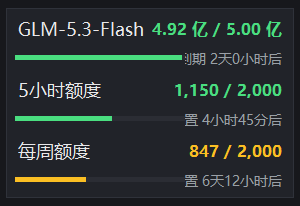

# ZCode 套餐额度悬浮窗

置顶小浮窗 + 系统托盘，实时显示 ZCode 套餐的剩余额度、进度条和重置倒计时。可显示的额度包括**订阅额度**（个人 Coding Plan）与**体验/活动套餐**两类。纯 Python 标准库，无第三方依赖。

## 启动

双击 `zcode-monitor.bat` 即可。

## 操作

| 操作 | 效果 |
|---|---|
| 按住浮窗拖动 | 移动位置 |
| 右键（浮窗或托盘图标） | 完整菜单 |
| 托盘图标左键 | 显示 / 隐藏浮窗 |
| 托盘图标悬停 | 各额度剩余百分比 |
| 托盘图标颜色 | 剩余最少的额度：绿 ≥50% / 黄 20–50% / 红 <20% / 灰 无数据 |

- 每 60 秒自动刷新；重复启动只保留一个浮窗
- 置顶被其他窗口抢掉会自动恢复；菜单里可关闭置顶、半透明、开机自启

## 常见问题

- **没看到浮窗**：看任务栏右下角托盘（可能收在 `^` 折叠区，名称“ZCode 套餐额度”），左键显示；或右键 → 重置位置
- **显示错误**：在 ZCode 客户端重新登录一次，下个刷新周期自动恢复

数据只读本机 `~/.zcode` 的登录凭证，留在本机不上传。
